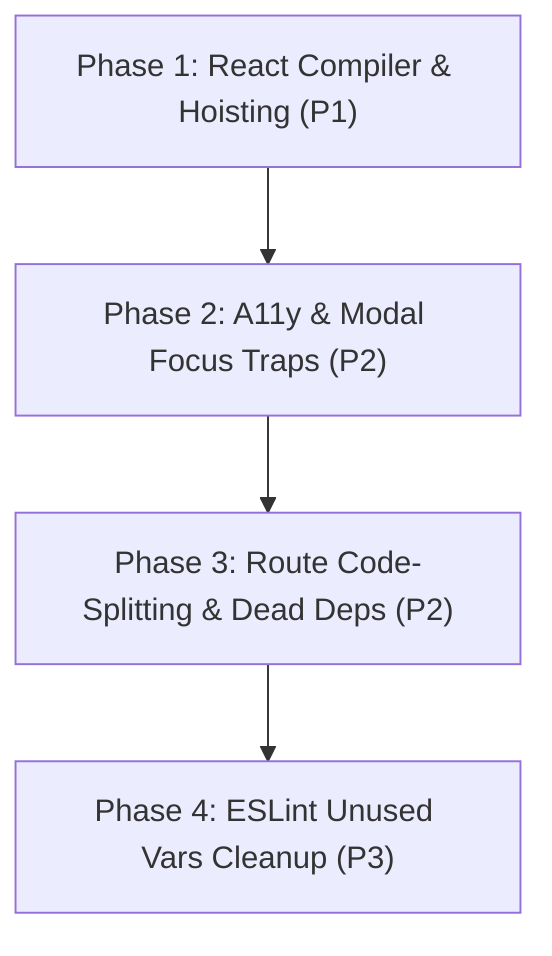

# Frontend Remaining Issues & Prioritized Remediation Roadmap
## School Management System — Post-Transformation Acceptance Audit

**Date:** November 13, 2026  
**Audit Commit:** `8c2ab3f`  
**Classification:** Non-blocking quality improvements & future optimization

---

## 1. Executive Summary of Remaining Issues

The transformation successfully redesigned all 53 JSX pages, unified the design system, removed hardcoded fake data, and established zero compilation/build errors. The backend freeze was 100% maintained with zero backend modifications.

However, the comprehensive audit identified several technical debt items and optimization opportunities that should be addressed in a dedicated frontend-only cleanup phase.

| Priority | Category | Issues Count | Summary |
|----------|----------|--------------|---------|
| 🔴 **P1 - High** | React Compiler & Hoisting | 60 | `react(immutability)`: fetch functions called in `useEffect` before declaration |
| 🔴 **P1 - High** | Hooks Dependencies | 25 | `react-hooks(exhaustive-deps)`: missing dependency array items |
| 🟡 **P2 - Medium** | Accessibility (A11y) | 5 | Modal focus trap, missing `aria-labelledby`, unlabeled icon buttons |
| 🟡 **P2 - Medium** | Bundle Optimization | 2 | Duplicate toast library (`react-hot-toast`), bundle chunking (>500kB) |
| 🟡 **P2 - Medium** | Error State UI Uniformity | 2 | Coordinator & SuperAdmin dashboards coerce to 0 instead of `ErrorState` |
| 🟢 **P3 - Low** | Dead Code / Imports | 118 | `no-unused-vars` (unused icons and components) |
| 🟢 **P3 - Low** | Fast Refresh & Form State | 13 | Synchronous `setState` in form population `useEffect` |

---

## 2. Detailed Issue Catalog

### 2.1 P1 — React Architecture & Hoisting (`react(immutability)`)
- **Count:** 60 warnings across ~35 page components
- **Impact:** React 19 Compiler skips optimization on these components. If functions are called prior to initialization in complex render flows, could lead to temporal dead zone or stale closures.
- **Affected Files:**
  - `src/pages/admin/Results.jsx` (lines 52–55)
  - `src/pages/admin/Timetable.jsx` (lines 67–70)
  - `src/pages/admin/Attendance.jsx` (lines 33, 38, 39)
  - `src/pages/admin/Classes.jsx` (lines 63, 64)
  - `src/pages/admin/Exams.jsx` (lines 57–59)
  - `src/pages/admin/Fees.jsx` (lines 55, 56)
  - `src/pages/admin/Students.jsx` (lines 56, 57)
  - `src/pages/student/Dashboard.jsx` (line 41)
  - `src/pages/teacher/Dashboard.jsx` (line 39)
  - `src/pages/parent/Dashboard.jsx` (line 25)
  - (and 25 other files)
- **Root Cause:** Standard pattern used:
  ```jsx
  useEffect(() => {
    fetchData(); // Called here
  }, []);
  const fetchData = async () => { ... }; // Defined below
  ```
- **Remediation:** Either wrap `fetchData` in `useCallback` defined *above* `useEffect`, or define the fetch function directly inside the `useEffect`:
  ```jsx
  useEffect(() => {
    const fetchData = async () => { ... };
    fetchData();
  }, []);
  ```

---

### 2.2 P1 — Hooks Exhaustive Dependencies (`react-hooks/exhaustive-deps`)
- **Count:** 25 warnings
- **Impact:** Stale closures when reactive dependencies (like filter state, date pickers, or IDs) change without triggering re-fetch.
- **Key Examples:**
  - `src/pages/admin/Results.jsx:56` — `useEffect` uses `fetchResults` but misses dependencies
  - `src/pages/admin/Attendance.jsx` — missing class/date filter dependency
  - `src/pages/parent/Attendance.jsx` — missing `selectedChild` dependency
- **Remediation:** Consolidate data-fetching dependencies with `useCallback` or pass explicit parameters.

---

### 2.3 P2 — Accessibility (A11y) Refinements
- **Issues:**
  1. **Modal Focus Trap (`src/components/common/Modal.jsx`):** Modal opens with `role="dialog"` and `aria-modal="true"`, but does not trap keyboard Tab cycling inside the modal DOM. Tabbing can escape to underlying page elements.
  2. **Modal `aria-labelledby` (`src/components/common/Modal.jsx`):** Missing programmatic linkage between the dialog container and the title `<h3>`.
  3. **Sidebar `<nav>` Landmark (`src/components/common/Sidebar.jsx`):** `<nav>` element lacks `aria-label="Main navigation"`.
  4. **Collapsed Sidebar Icon Buttons (`src/components/common/Sidebar.jsx`):** When sidebar is collapsed to icon-only mode, the collapse button and logout button lack explicit `aria-label` attributes.
  5. **Navbar Search Modal Close (`src/components/common/Navbar.jsx:300`):** Icon-only close button renders `<FiX />` without `aria-label="Close search"`.
- **Remediation:** Add `aria-label`, `aria-labelledby`, and implement a lightweight focus-trap utility.

---

### 2.4 P2 — Bundle Size & Duplicate Dependencies
- **Issues:**
  1. **Duplicate Toast Libraries:** Both `react-toastify` (^11.1.0) and `react-hot-toast` (^2.6.1) are listed in `package.json`. The application codebase exclusively uses `react-toastify`. `react-hot-toast` is dead weight adding ~20kB to dependencies.
  2. **Monolithic Bundle Size:** Vite warns that `dist/assets/index-DG3wPNec.js` is 1,307 kB minified (344 kB gzip). Recharts, Framer Motion, and all 53 page routes are currently bundled into a single entry chunk.
- **Remediation:**
  - Remove `react-hot-toast` from `package.json`.
  - Introduce route-level code splitting using `React.lazy()` and `<Suspense>` in `src/App.jsx`. Each of the 7 role portals will then load its own chunk on demand, dropping initial bundle size below 200kB.

---

### 2.5 P2 — Error State Consistency in Dashboard Pages
- **Issues:**
  1. `src/pages/coordinator/Dashboard.jsx`: Catches API error and silently defaults to `{}`. Renders stats as `0` rather than presenting an `ErrorState` retry card.
  2. `src/pages/superadmin/Dashboard.jsx`: Catches API error and leaves initial `{ totalSchools: 0, ... }`. Does not display an `ErrorState` banner.
- **Remediation:** Add `error` boolean state and render `<ErrorState title="Failed to load dashboard" onRetry={fetchStats} />` consistent with `admin/Dashboard.jsx`.

---

### 2.6 P3 — Code Cleanup (`no-unused-vars`)
- **Count:** 118 warnings
- **Details:** Imported icons from `react-icons/fi` that were planned or replaced during redesign (e.g. `FiUsers`, `FiShield` in `superadmin/Users.jsx`).
- **Remediation:** Run a cleanup script to prune unused imports across all files.

---

## 3. Prioritized Remediation Plan



| Phase | Target Scope | Est. Effort | Expected Outcome |
|-------|--------------|-------------|------------------|
| **Phase 1** | Hoist all fetch functions & fix `useEffect` dependencies | 2 hours | 0 `react(immutability)` warnings, 0 `exhaustive-deps` warnings |
| **Phase 2** | A11y attributes & focus trap in `Modal.jsx`, `Sidebar.jsx`, `Navbar.jsx` | 1 hour | WCAG 2.1 AA compliant dialog & navigation |
| **Phase 3** | `React.lazy()` route splitting + remove `react-hot-toast` | 1 hour | Initial JS bundle < 250kB (no Vite size warning) |
| **Phase 4** | Clean up 118 unused imports & console statements | 1 hour | 0 ESLint warnings across entire repository |

